<div align="center">

# 🧤 GestureTalk

### A sensor glove that learns *your* signs and speaks for you

**For people who have lost their voice to ALS/MND, stroke, cerebral palsy, a tracheostomy or a ventilator.**
No sign language needed. Teach the glove a movement you *can* make, and it says the words you choose.

[](#testing)
[-2457c5?style=flat-square)](#performance)
[](hardware/glove/README.md)
[](#privacy-and-safety)
[](LICENSE)

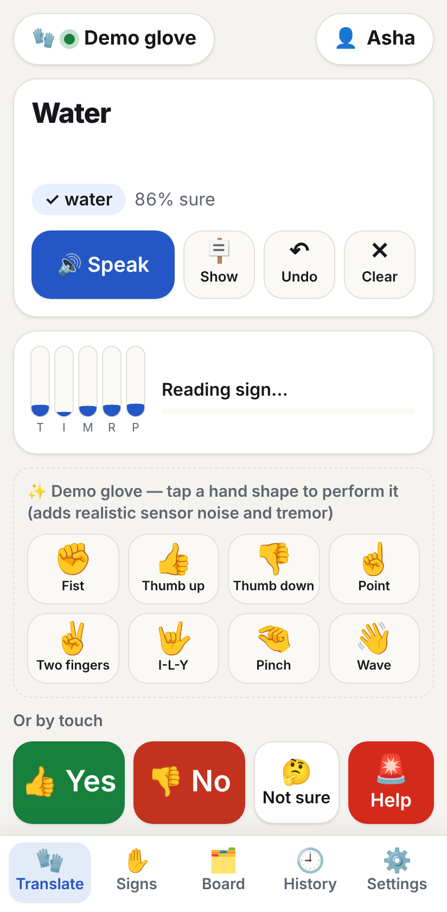
&nbsp;
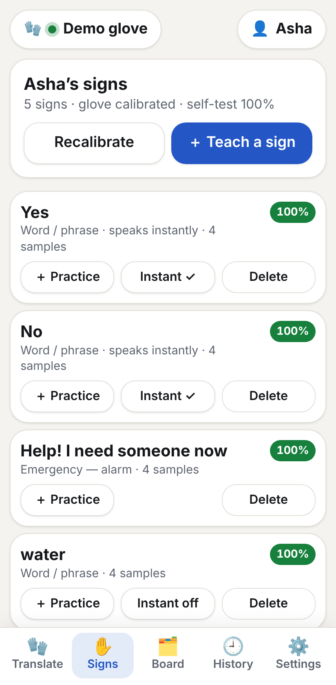
&nbsp;
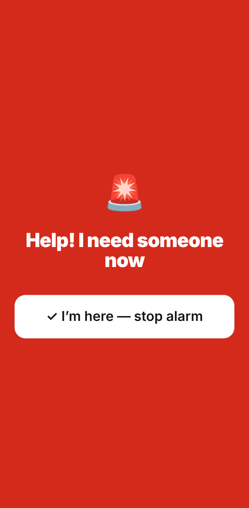

</div>

---

## Contents

- [The problem](#the-problem)
- [What GestureTalk does](#what-gesturetalk-does)
- [How it compares](#how-it-compares)
- [Screenshots](#screenshots)
- [Architecture](#architecture)
- [How recognition works](#how-recognition-works)
- [Performance](#performance)
- [The glove (hardware)](#the-glove-hardware)
- [Getting started](#getting-started)
- [Project structure](#project-structure)
- [Testing](#testing)
- [Privacy and safety](#privacy-and-safety)
- [Roadmap](#roadmap)
- [Acknowledgements](#acknowledgements)

---

## The problem

When someone loses speech through ALS, a stroke or a breathing tube, they still have a lot to say: *I'm in pain*, *turn me over*, *call my daughter*, *I love you*. The tools they're offered usually fall short:

- **Sign-language gloves** recognise a fixed alphabet or word list, trained on fluent, able-bodied signers. Most people who lose speech later in life never learned to sign, and their hands often can't form textbook handshapes.
- **Eye-gaze and AAC devices** work, but they cost ₹80,000–₹12,00,000 and are rarely available on a hospital ward.
- **Letter boards** are free, but slow, and depend on someone patiently watching.

## What GestureTalk does

GestureTalk turns **whatever hand movement a person can still make** into speech:

1. **Calibrate** (10 s): relax, then bend as far as is comfortable. Fingers that can't move are detected and ignored.
2. **Teach** (about 20 s per sign): do the movement 4 times and choose what it means: a word, a phrase, or an action like *speak* or *emergency*.
3. **Talk**: sign, and the app shows the words in large text, speaks them aloud, and raises an alarm for emergencies.

It runs on any phone or tablet browser, works offline, and the glove costs about ₹4,000 in parts.

The glove can also drive the whole app hands-free: *next* and *select* signs move a highlight through the touch phrase boards and press buttons. A carer button on the glove's wrist pod stops an alarm or speaks the current sentence.

## How it compares

Sign-language gloves are a well-explored idea: [SignAloud](https://www.kqed.org/futureofyou/165394/invention-translates-sign-language-into-speech-some-in-deaf-community-unimpressed) (University of Washington, 2016), [SignSpeak](https://arxiv.org/html/2407.12020v2) (2024, open dataset), and many ESP32/Arduino projects. They were built to translate a sign language. GestureTalk is built for people who **can't** use one.

| | Typical sign-language glove | **GestureTalk** |
|---|---|---|
| Designed for | Fluent signers | **Anyone who can move a hand a little**: ALS, stroke, CP, ICU |
| Vocabulary | Fixed alphabet or word list | **Each person's own signs**, in any language |
| Limited finger movement | Fails | **Unused fingers are detected and ignored** |
| Changing ability (e.g. ALS) | Retrain from scratch | **Learns from use**: confirmed signs become new examples |
| Unclear sign | Outputs its best guess | **Rejects it** and shows confidence. One-tap undo. |
| Quality feedback | None | **Self-test score per sign**, plus warnings when two signs are too alike |
| Emergencies | — | **Help sign → full-screen alarm** until a carer responds |
| Without the glove | Nothing | Touch phrase boards, pain scale, keyboard, switch scanning |
| Try before building | Need the hardware | **Built-in demo glove** with realistic noise and tremor |
| Data | Often cloud-processed | **On-device**. Nothing uploaded. |

## Screenshots

| Start | Calibrate | Teach a sign | Record |
|:---:|:---:|:---:|:---:|
| 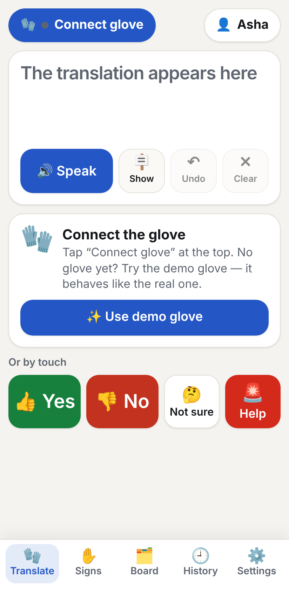 | 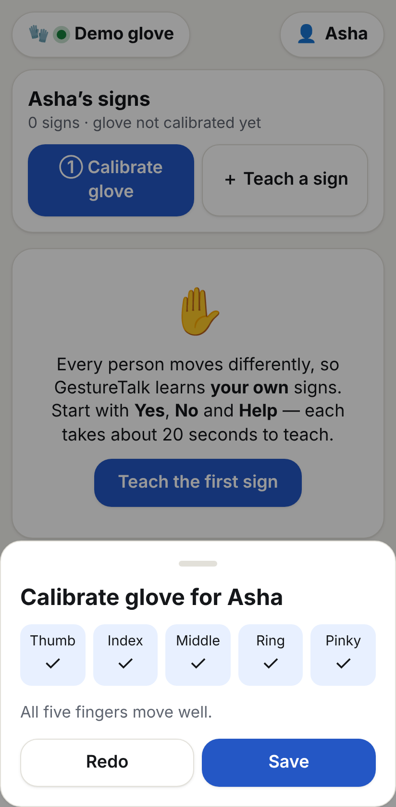 | 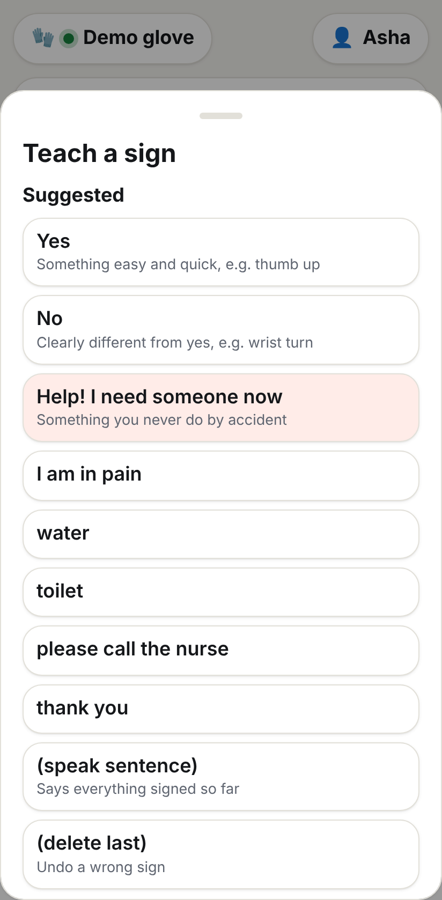 | 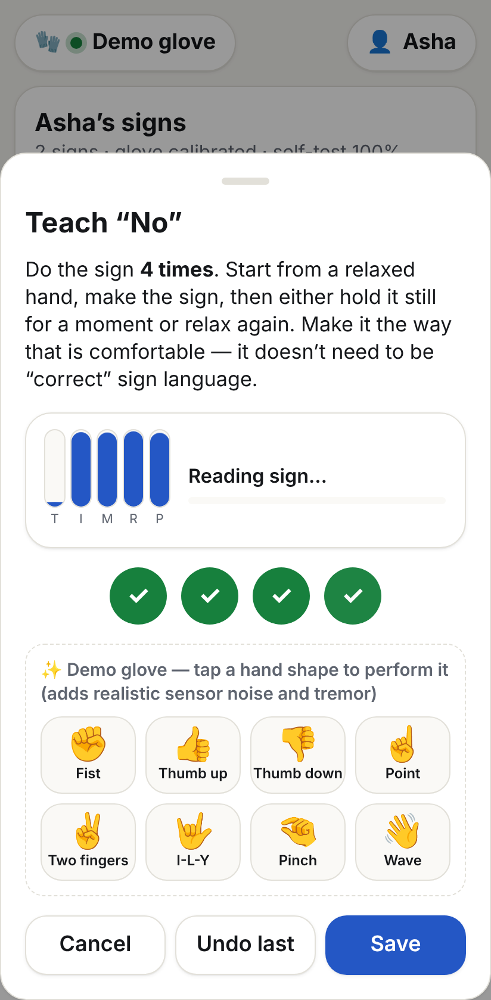 |
| **Translate** | **Sign library** | **Emergency** | **Touch board** |
|  |  |  | 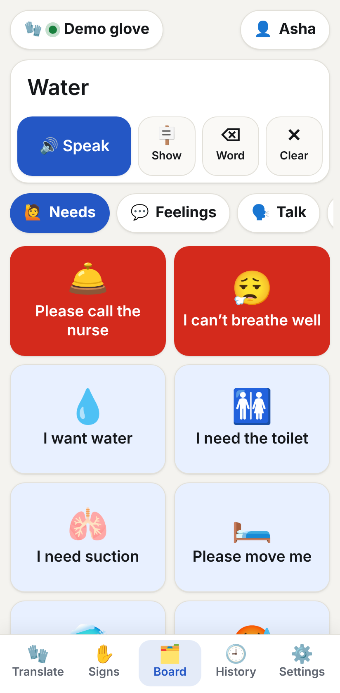 |

All screenshots were taken from the running app using the built-in demo glove.

## Architecture

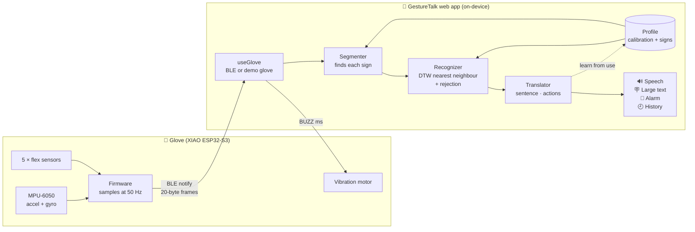

The glove only **measures**; all learning happens in the app. A person's signs can be taught, improved and backed up without reflashing, one glove can serve several patients, and recognition improves with app updates.

## How recognition works

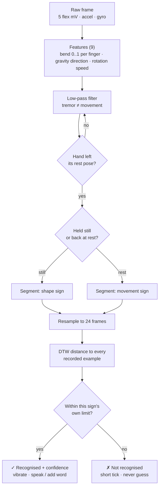

- **Personal calibration** maps each finger to 0 (relaxed) … 1 (fullest comfortable bend). This works whichever way the sensor voltage moves, and it ignores fingers whose range is under 120 mV.
- **Segmentation** waits for the hand to leave the rest pose. The sign ends when the hand holds still (~0.35 s) or returns to rest. One held sign fires exactly once.
- **Matching** uses [dynamic time warping](https://en.wikipedia.org/wiki/Dynamic_time_warping) with a Sakoe–Chiba band, weighting finger bend over orientation over motion. It handles signs made faster or slower than when they were taught.
- **Rejection limits** are set per sign from how consistent that person's own examples are. A person with tremor gets wider limits automatically, and the global strictness setting can shift them.
- **Self-test** runs leave-one-out on every example. It shows which signs need more practice and which ones get confused.

The whole recognizer is under 300 lines of dependency-free TypeScript ([`app/lib/recognizer.ts`](app/lib/recognizer.ts)) and takes about 2 ms per sign.

## Performance

Measured with `npm run benchmark` ([`scripts/benchmark.bench.ts`](scripts/benchmark.bench.ts)). Setup: 7 taught signs, 4 training examples each, 15 test performances per sign. An 8th, untaught sign checks that unknown movements are rejected. Raw results: [`docs/benchmark.json`](docs/benchmark.json).

| Hand condition | Trials | Correct | **Wrong sign** | Not recognised (retry) | Untaught sign rejected | Time / sign |
|---|---:|---:|---:|---:|---:|---:|
| Steady | 105 | 100 % | **0 %** | 0 % | 100 % | 1.8 ms |
| Mild tremor | 105 | 90.5 % | **0 %** | 9.5 % | 100 % | 1.9 ms |
| Strong tremor | 100 | 97 % | **0 %** | 3 % | 100 % | 1.8 ms |

When it is unsure, GestureTalk asks for a retry rather than saying the wrong thing. In a hospital, a missed "yes" is an inconvenience, but a false "yes" can be harm.

> ⚠️ **These numbers come from the simulated demo glove** (realistic sensor noise and adjustable tremor), not from patients. They show the pipeline behaves as designed. Real-world accuracy has to be measured in supervised trials with real users. The tremor results vary a little between runs because the simulation is random.

## The glove (hardware)

<p align="center">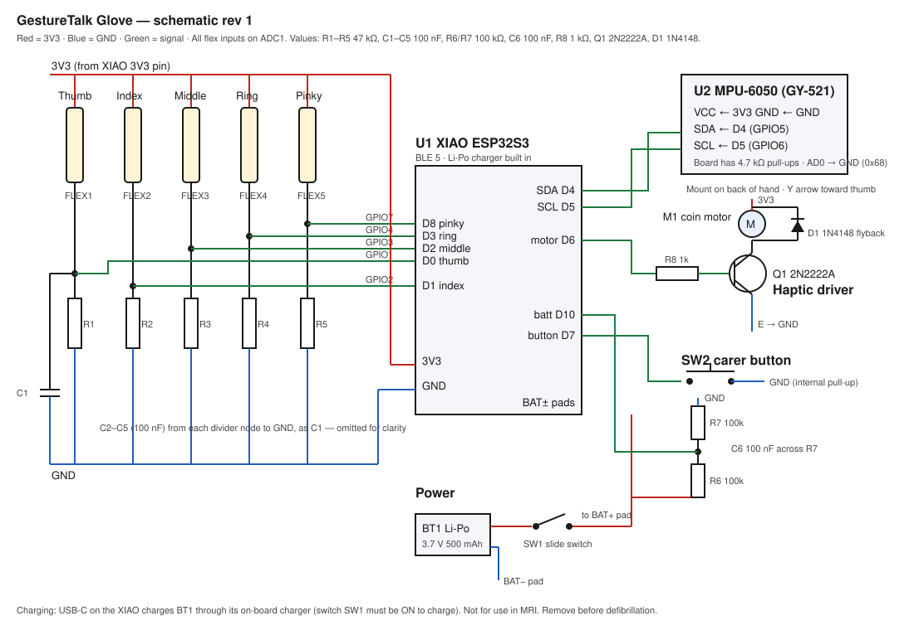</p>

| Part | Qty | Approx. ₹ |
|---|---:|---:|
| Seeed XIAO ESP32-S3 (BLE 5, Li-Po charger) | 1 | 900 |
| Flex sensor 2.2" | 5 | 1,750 |
| MPU-6050 (GY-521) | 1 | 150 |
| Coin vibration motor + 2N2222A + 1N4148 | 1 | 70 |
| 3.7 V 500 mAh Li-Po with protection | 1 | 350 |
| Resistors, capacitors, switch, button, wire, enclosure | — | 450 |
| Latex-free stretch gloves (2, so one can be washed) | 2 | 200 |
| **Total** | | **≈ ₹4,000 (≈ US$50)** |

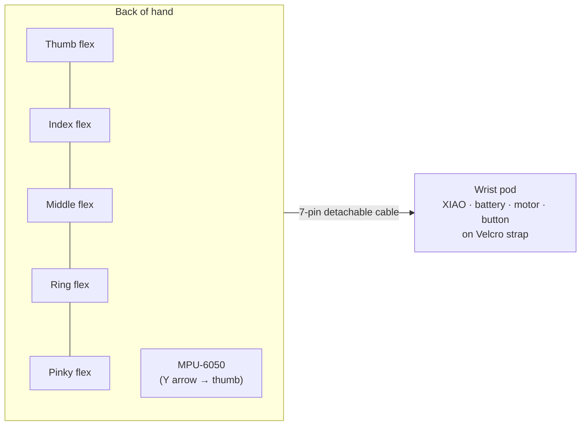

The full guide is in **[hardware/glove/README.md](hardware/glove/README.md)**: wiring table, 6-step build workflow, firmware flashing, 3D-printable pod ([`enclosure.scad`](hardware/glove/enclosure.scad)), bedside checklist, safety and troubleshooting.

**BLE protocol:** service `6e7a0001-…`, with a frame characteristic (20 bytes at 50 Hz: `uint16[5]` flex mV · `int16[3]` accel milli-g · `int8[3]` gyro °/s÷8 · button + sequence), battery %, and a `BUZZ <ms>` command. Any hardware that streams this format works with the app.

## Getting started

```bash
git clone https://github.com/mahak867/gesture-communication-app.git
```
```bash
cd gesture-communication-app
```
```bash
npm install
```
```bash
npm run dev
```

Open http://localhost:3000, then:

1. Tap **Connect glove → Try the demo glove**. (Use Chrome or Edge for a real glove: they support Web Bluetooth.)
2. Go to **Signs → Calibrate glove**, then **Teach a sign**. Use the demo hand-shape buttons to perform signs.
3. Go back to **Translate** and sign.

Optional: local AI sentence suggestions on the keyboard need [Ollama](https://ollama.com). Copy `.env.example` to `.env.local` and turn it on in **Settings**.

## Project structure

```
app/
├── lib/                    Pure, unit-tested logic
│   ├── translate.ts        What a recognised sign does (words, actions, navigation)
│   ├── sensors.ts          BLE frame format, calibration, feature extraction
│   ├── recognizer.ts       Segmenter, DTW, classification, self-test
│   ├── profiles.ts         People, signs, starter vocabulary, validation
│   ├── simulator.ts        Demo glove (hand shapes, noise, tremor)
│   ├── vocab.ts            Touch-board phrases (English / हिन्दी), pain scale
│   └── prediction.ts       Offline word prediction for the keyboard
├── hooks/
│   ├── useGlove.tsx        Web Bluetooth + demo glove, auto-reconnect
│   ├── useProfiles.tsx     Profiles, signs, backup/restore
│   ├── useTranslator.tsx   Recognition → sentence, actions, learn-from-use
│   └── useSegments.ts      Shared frame → segment pipeline
├── components/             Translate, Signs, RecordSign, Calibrate, Board, …
└── api/suggest/            Optional local-AI sentence suggestions
hardware/glove/             Build guide, schematic, firmware, enclosure
scripts/benchmark.bench.ts  Recognition benchmark → docs/benchmark.json
scripts/e2e.cjs             End-to-end browser test with the demo glove
hardware/glove/firmware/test/  Firmware host tests, stub headers, golden vectors
docs/images/                Screenshots
```

## Testing

```bash
npm test
```
```bash
npm run test:firmware
```
```bash
npm run e2e
```
```bash
npm run benchmark
```

| Suite | What it proves |
|---|---|
| **46 unit tests** (Vitest) | Segmentation (one segment per sign, silence at rest), few-shot recognition of every taught sign, thumb up vs down by orientation, rejection of untaught signs, leave-one-out accuracy, sentence and action logic, learn-from-use rules, calibration with paralysed or broken fingers, profile validation for imported files, word prediction (including Hindi) |
| **Firmware host tests** (g++) | Frame packing, sensor unit conversions, battery %, `BUZZ` command parsing, sensor-fault detection. The full sketch is also compiled with `-Wall -Werror` against stand-in Arduino/BLE headers |
| **Firmware ↔ app compatibility** | Byte sequences produced by the firmware's own C++ packing code must decode identically in the app's TypeScript, and re-encode byte-for-byte |
| **15 end-to-end checks** (Chromium) | The real app with the demo glove: calibrate → teach 5 signs → translate → reject an unknown sign → emergency alarm and acknowledge → history → hands-free board navigation, with zero console errors |

CI ([`.github/workflows/ci.yml`](.github/workflows/ci.yml)) runs all four on every push: type-check, lint, unit tests, build, firmware tests (including a check that the reference vectors are up to date), and the end-to-end run.

> The firmware has been compiled against stand-in headers, not yet with the real ESP32 toolchain. Build it once in the Arduino IDE before first use (see the hardware guide).

## Privacy and safety

- **On-device:** glove data, recordings and history never leave the device. There is no account, no analytics and no cloud.
- **Offline:** installable as an app (PWA). After the first load it works without internet.
- **Not a medical device:** use it alongside the hospital's nurse-call system, never instead of it. Remove the glove before MRI or defibrillation. The hardware guide has the full hygiene and safety checklist.

## Roadmap

- [ ] Supervised trials with ALS and stroke patients and their speech-language therapists
- [ ] Two-glove signing
- [ ] Fabric (Velostat) sensors to bring the glove under ₹1,000
- [ ] More languages for the touch boards (Tamil, Bengali, Marathi…)
- [ ] Opt-in, anonymised dataset of accessible signs to give new users a head start
- [ ] Custom PCB

## Acknowledgements

Prior work that shaped this project: [SignSpeak](https://arxiv.org/html/2407.12020v2) (open flex-glove dataset and time-series models), [Cboard](https://www.cboard.io/) and [AsTeRICS Grid](https://github.com/asterics/AsTeRICS-Grid) (open-source AAC), and the [Deaf community's critique](https://www.kqed.org/futureofyou/165394/invention-translates-sign-language-into-speech-some-in-deaf-community-unimpressed) of sign gloves built without their input. That critique is why GestureTalk is built around what each user can do, rather than a fixed language.

## License

[MIT](LICENSE) © mahak867
