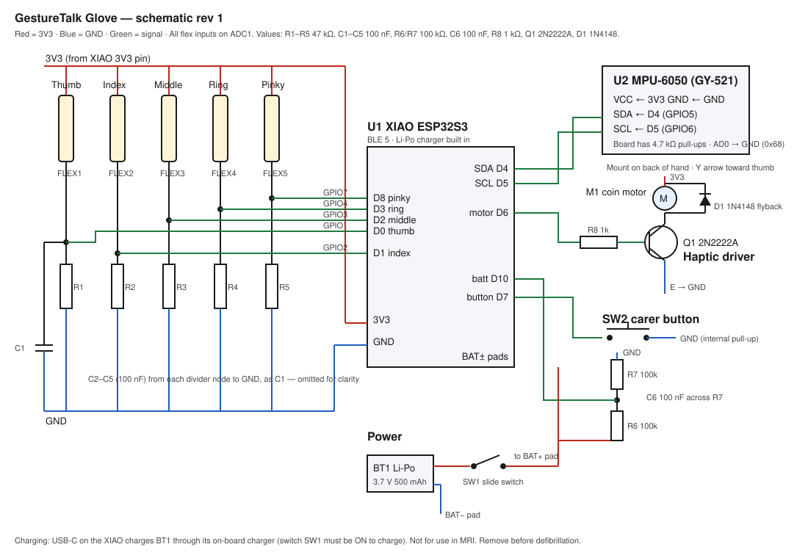

# GestureTalk Glove

The glove is the main way to use GestureTalk. Five flex sensors and a motion sensor read the hand. The glove recognises a small set of gestures itself and sends them to the app over Bluetooth. The app then speaks, moves the highlight, or raises the alarm.

| Gesture | Event | What the app does |
|---|---|---|
| ☝️ Point with index finger (hold ~0.6 s) | `NEXT` | Moves the highlight forward. Keeps repeating while held. |
| ✌️ Index + middle finger | `PREV` | Moves the highlight back |
| ✊ Short fist, then release | `SELECT` | Presses the highlighted button |
| ✊ Fist held 3 s (warning buzz at 1.5 s) | `HELP` | Full-screen urgent alarm with sound |
| 👍 Thumb up | `YES` | Says "Yes" |
| 👎 Thumb down (hand turned over) | `NO` | Says "No" |
| ✋ Open, relaxed hand | — | Rest. Nothing happens. |

Why so few gestures? Hospital patients are often weak, sedated or have a tremor, and a misread such as a false "yes" can be dangerous. Previous GestureTalk versions tried fingerspelling and failed for those reasons. The glove uses large, distinct hand shapes, each held steady before it counts. With point / fist alone, the glove can still reach every button in the app (switch-scanning style), so typing works too.

**Limited finger movement?** Calibration measures how far each finger moves. A finger that barely moves is marked *ignored*, so it doesn't block any gesture. For example, someone who can only move thumb and index finger can still use NEXT, SELECT/HELP and YES/NO.

---

## 1. Parts list (one glove)

| Ref | Part | Qty | Notes | Approx. cost (₹) |
|---|---|---|---|---|
| U1 | **Seeed XIAO ESP32S3** | 1 | BLE 5, USB-C, built-in Li-Po charger, tiny | 900 |
| FLEX1–5 | Flex sensor 2.2" (Spectra Symbol FS-L-0055 or equivalent) | 5 | Use 4.5" for adult index/middle fingers if available | 5 × 350 |
| U2 | MPU-6050 breakout (GY-521) | 1 | Detects thumb up vs down | 150 |
| M1 | 10 mm coin vibration motor, 3 V | 1 | Haptic confirmation | 60 |
| Q1 | 2N2222A NPN transistor (or AO3400 MOSFET) | 1 | Motor driver | 5 |
| D1 | 1N4148 diode | 1 | Flyback protection | 2 |
| R1–R5 | 47 kΩ resistor, 1/4 W | 5 | Flex divider. Tune to roughly the sensor's mid-bend resistance. | 5 |
| R6, R7 | 100 kΩ resistor | 2 | Battery voltage divider | 2 |
| R8 | 1 kΩ resistor | 1 | Transistor base | 1 |
| C1–C6 | 100 nF ceramic capacitor | 6 | ADC noise filtering | 10 |
| BT1 | 3.7 V Li-Po, 400–600 mAh, **with protection circuit**, JST-PH | 1 | Lasts about 10–14 h | 350 |
| SW1 | Mini slide switch | 1 | Power | 10 |
| SW2 | 6 mm tactile button | 1 | Hold 2 s to calibrate | 5 |
| — | Stretch glove, cotton/lycra, **latex-free** | 2 | Buy two, so one can be washed while the other is used | 200 |
| — | Perfboard 3 × 4 cm, or the PCB (see §7) | 1 | | 30 |
| — | Silicone-insulated wire 28–30 AWG, 6 colours | ~3 m | Silicone stays flexible | 150 |
| — | Heat-shrink tubing, Kapton tape | — | Strain relief at sensor pins | 50 |
| — | Sew-on fabric channels (or 3 mm elastic + thread) | 5 | Sensors slide inside so they can be removed | 50 |
| — | Velcro wrist strap + small enclosure (3D-printed from `enclosure.scad`, or a 50 × 35 × 15 mm ABS box) | 1 | Electronics pod on the back of the wrist | 100 |

**Total: roughly ₹4,000 (≈ US$50)** per glove.

## 2. Schematic



Wiring table (XIAO ESP32S3 pad → part):

| XIAO pin | GPIO | Connects to |
|---|---|---|
| D0 | 1 | Thumb divider node (FLEX1 / R1 junction) + C1 to GND |
| D1 | 2 | Index divider node + C2 |
| D2 | 3 | Middle divider node + C3 |
| D3 | 4 | Ring divider node + C4 |
| D8 | 7 | Pinky divider node + C5 |
| D4 | 5 | MPU-6050 SDA |
| D5 | 6 | MPU-6050 SCL |
| D6 | 43 | R8 1 kΩ → Q1 base |
| D7 | 44 | SW2 → GND (internal pull-up) |
| D10 | 9 | Junction of R6 (to BAT+) and R7 (to GND) + C6 |
| 3V3 | — | Top of every flex sensor, MPU VCC, motor + |
| GND | — | R1–R5 bottoms, MPU GND, Q1 emitter, SW2 |
| BAT+ / BAT− pads (underside) | — | Li-Po through SW1 |

Each flex divider is: `3V3 → flex sensor → node → 47 kΩ → GND`. As the finger bends, the sensor's resistance rises and the node voltage falls. The firmware works whichever direction the voltage moves, because calibration records both ends.

Only ADC1 pins (GPIO 1–10) are used for analog readings. ADC2 gives unreliable readings while Bluetooth is on.

## 3. Build workflow

```
 ┌─────────────┐   ┌──────────────┐   ┌─────────────┐   ┌──────────────┐   ┌──────────────┐   ┌────────────┐
 │ 1 Bench-test│ → │ 2 Solder pod │ → │ 3 Flash +   │ → │ 4 Sew glove  │ → │ 5 Calibrate  │ → │ 6 Patient  │
 │  on bread-  │   │  board       │   │  serial     │   │  channels,   │   │  on the      │   │  trial     │
 │  board      │   │              │   │  check      │   │  fit sensors │   │  wearer      │   │  checklist │
 └─────────────┘   └──────────────┘   └─────────────┘   └──────────────┘   └──────────────┘   └────────────┘
```

### Step 1: Breadboard test (≈1 h)
1. Put the XIAO on a breadboard. Wire one flex sensor and its 47 kΩ resistor to D1.
2. Flash the firmware (step 3). Open Serial Monitor at 115200 baud.
3. Bend the sensor. The voltage must change by at least **300 mV** between straight and bent. If it doesn't, change the 47 kΩ to a value close to the sensor's resistance at half bend. Measure that with a multimeter.
4. Add the other four sensors, the MPU-6050 and the motor, testing after each one.

### Step 2: Solder the electronics pod (≈2 h)
1. Lay out the five dividers, C1–C6, R6/R7 and the motor driver on a 3 × 4 cm perfboard. Mount the XIAO on header pins so it can be replaced.
2. Bring out a 7-pin connector (3V3, GND and the 5 finger signals; a JST-SH or a 2.54 mm header) so the glove can be detached for washing.
3. Solder the battery to the BAT+/BAT− pads under the XIAO, with SW1 in the positive lead. Insulate the pads with Kapton.
4. Hot-glue the MPU-6050 flat inside the lid, **Y-axis arrow pointing toward the thumb**.
5. Put everything in the enclosure. Leave holes for USB-C, SW1 and SW2. Glue the motor to the inside of the floor so the wearer feels it against the wrist.

### Step 3: Flash the firmware (≈15 min)
1. Install the **Arduino IDE 2**. Under *Boards Manager*, install **esp32 by Espressif (3.x)**.
2. Select board **XIAO_ESP32S3** and the right port.
3. Open `firmware/gesturetalk_glove/gesturetalk_glove.ino` and upload. No extra libraries are needed.

   Or use the command line:
   ```bash
   arduino-cli compile --fqbn esp32:esp32:XIAO_ESP32S3 firmware/gesturetalk_glove
   ```
   ```bash
   arduino-cli upload  --fqbn esp32:esp32:XIAO_ESP32S3 -p /dev/ttyACM0 firmware/gesturetalk_glove
   ```
4. In Serial Monitor you should see `IMU ok` and a line like `bend 0.12 0.08 …` four times a second.

### Step 4: Make the glove (≈2 h)
1. Sew a fabric channel (a pocket about 8 mm wide) along the **back** of each finger, from the knuckle to just before the fingertip. Leave the knuckle end open.
2. Slide each flex sensor in **printed side away from the finger**, with the pins at the knuckle end. The sensor must bend over the middle finger joint.
3. Strain relief is the most common failure point. Heat-shrink the sensor pins, then tape the wire to the glove 1 cm behind the pins so pulling never reaches the sensor.
4. Run the wires along the back of the hand to the pod connector. Leave slack loops at the wrist.
5. Fix the pod to a Velcro wrist strap, not the glove, so the glove can be washed.

### Step 5: Calibrate on the wearer (≈1 min, redo for each new wearer)
1. Put the glove on the patient and switch it on. In the app, press **Connect glove** and choose *GestureTalk Glove*.
2. Press **Calibrate** in the app, or hold the button on the pod for 2 s.
3. Follow the buzzes: one buzz means *open and relax the hand* (2 s). Two buzzes mean *make a gentle fist* (2 s). A long buzz means done.
4. Fingers that moved less than 150 mV are marked ignored. Serial Monitor shows which ones.
5. Calibration is saved on the glove and survives power-off.

### Step 6: Bedside checklist before relying on it
- [ ] Each gesture in the table above fires reliably 5 out of 5 times, without false triggers during 2 minutes of rest and normal movement.
- [ ] HELP alarm is loud enough to hear from the nurses' station / doorway.
- [ ] Carer knows how to acknowledge the alarm, recharge (USB-C, about 1.5 h) and recalibrate.
- [ ] Battery shows in the app, and the app warns below 20%.
- [ ] Skin checked after 1 hour of wear (pressure marks, sweating). Remove the glove for at least 15 min every 2 hours.
- [ ] Touch-screen and yes/no card backups are within reach.

## 4. Safety and hygiene

- **This is not a medical device or a nurse-call system.** Use it alongside the hospital's call bell, never instead of it.
- Use a Li-Po **with a protection circuit**. Do not charge it unattended or under bedding. Stop using any battery that is swollen.
- Remove the glove before MRI, defibrillation, or procedures with electrosurgery.
- Do not use on broken skin, IV/cannula sites, or a limb with an arterial line.
- The glove is personal to one patient. Between uses, remove the sensors, wash the glove at 60 °C, and wipe the pod with 70% alcohol. Never immerse the pod.
- Choose latex-free materials. Check for nickel or adhesive allergies.

## 5. Troubleshooting

| Symptom | Fix |
|---|---|
| App can't find the glove | It only works in Chrome or Edge. Turn on Bluetooth and location (Android needs it for BLE). Switch the glove off and on again. |
| A gesture never triggers | Recalibrate with a *gentle* fist, not a hard one. Check Serial Monitor: the bend value should go above 0.6 for "bent" fingers and below 0.35 for "straight" ones. |
| Random triggers at rest | Recalibrate with the hand truly relaxed. Increase `HOLD_MS` in the firmware. |
| One finger always reads 0 or 1 | Broken wire or cracked sensor. Check the solder joints at the pins first. |
| Thumb down says "Yes" | The MPU-6050 is missing or mounted the wrong way. The Y arrow must point toward the thumb. Check for `IMU ok` on boot. |
| Readings jump when Bluetooth connects | A flex sensor is on an ADC2 pin, or the 100 nF capacitor is missing. |

## 6. Protocol (for developers)

BLE service `6e7a0001-5a1f-4c2b-9d3e-7f1a2b3c4d5e`:

| Characteristic | UUID suffix | Properties | Payload |
|---|---|---|---|
| Event | `…0002…` | notify | UTF-8: `YES` `NO` `NEXT` `PREV` `SELECT` `HELP` `CAL_OPEN` `CAL_FIST` `CAL_DONE` |
| Battery | `…0003…` | read, notify | UTF-8 integer 0–100 |
| Command | `…0004…` | write | `CAL` (calibrate) · `BUZZ` (test the motor) |

The app side lives in `app/lib/glove.ts` and `app/components/GloveConnect.tsx`. Any device that sends these events will work, for example a single big-button switch or a sip-and-puff sensor sending `NEXT`/`SELECT`.

## 7. Next revision ideas
- Custom 2-layer PCB (KiCad) to replace the perfboard.
- Fabric (Velostat/conductive-thread) bend sensors to bring cost below ₹1,000.
- Deep sleep after 10 minutes of no movement, to extend battery life.
